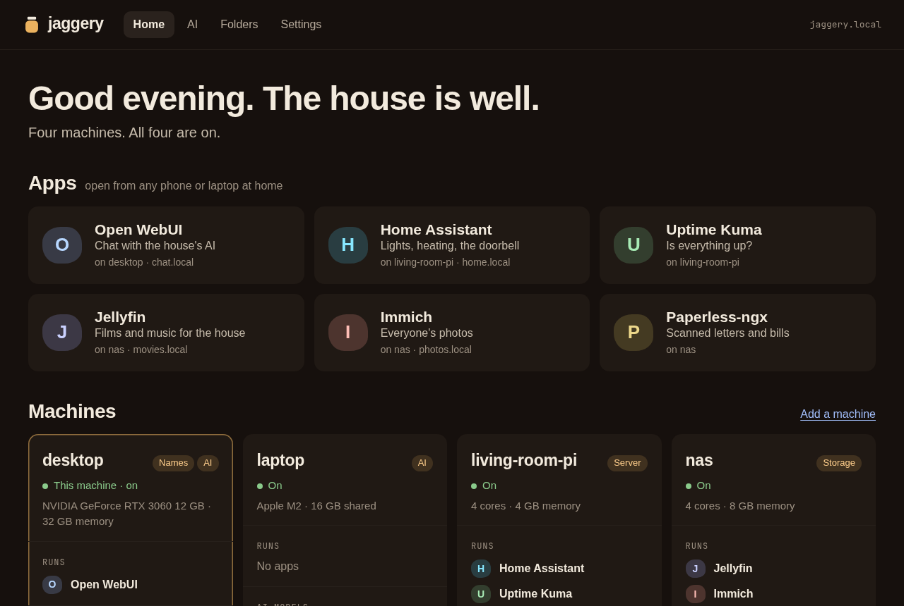
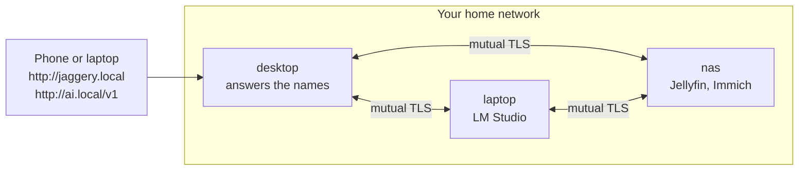

<div align="center">


# Jaggery

**Every computer in your home, working as one.**

[](https://github.com/jaggery-dev/jaggery/releases/latest)
[](LICENSE)
[](https://github.com/jaggery-dev/jaggery/discussions)

[Website](https://jaggery.dev) · [Getting started](docs/getting-started.md) · [Docs](docs/README.md) · [Known issues](docs/known-issues.md) · [Discussions](https://github.com/jaggery-dev/jaggery/discussions)

</div>

Jaggery is a small program you run on each computer in your house. They find each other, show up on one page, and share their AI models through one address. No account, no router changes, nothing to configure.

> **Public alpha.** Jaggery is early (v0.x): it works in our houses, and we want to hear where it doesn't work in yours. Read the [known issues](docs/known-issues.md), and please [tell us](#feedback) what you find.

<p align="center">
  
</p>

<p align="center"><sub>The page at <code>jaggery.local</code>, for a made-up house. More: <a href="assets/screenshots/page-ai.png">the AI view</a>, <a href="assets/screenshots/page-home-phone.png">on a phone</a>.</sub></p>

## Two commands to add a machine

```console
desktop $ jag invite
on the machine you want to add, run:
    jag join amber-attic-barley-brook-basil-acorn

laptop  $ jag join amber-attic-barley-brook-basil-acorn
joined the house through desktop
both machines now trust each other.
```

Then open **http://jaggery.local** on any phone or laptop at home.

## What you get

- **One page for the house** at `jaggery.local`: every machine, its memory, disks and GPU, and the self-hosted apps it runs (Jellyfin, Immich, Home Assistant and [17 more](internal/apps/apps.go)). Works on a phone.
- **Short names for apps**: `jag apps name "Open WebUI" chat`, and every device in the house opens it at `http://chat.local`, whichever machine and port it's on.
- **One address for AI** at `ai.local`: an OpenAI-compatible endpoint (chat and embeddings) in front of Ollama, LM Studio, llama.cpp and vLLM on every machine, which also speaks Ollama's own API for apps that only know Ollama. Each request goes to the machine that has the model loaded, or ran it fastest. A new model stays off `ai.local` until you approve it.
- **Folders for models and agents**: lend a folder with `jag share add`, and AI apps read it (and, if you allow it, write to it) through the MCP server at `ai.local/mcp`. Every access is logged, and old versions are kept for 30 days.
- **Hosted models, only if you add them**: providers and models you allow, a spending cap, and every request kept word for word (`jag outbound`).
- **Nothing out of sight**: `jag activity` shows who used which model on which machine; `jag files log` shows what agents read and changed.
- **It looks after itself**: signed updates roll out one machine at a time and undo themselves if a build won't start. `jag doctor` checks the machine and its network, and says what to type to fix what fails.

## Get started

On each machine:

```sh
curl -fsSL https://jaggery.dev/install | sh
```

The script picks the build for the machine, checks it against the release's signed checksums, and installs Jaggery as a service; it asks for `sudo` once. [Read it first](scripts/get.sh) if you like: that's what it's for. Then run `jag invite` on the first machine and `jag join <code>` on the next. The walk-through, including the Mac's one-time network permission, is in **[Getting started](docs/getting-started.md)**. To remove it: `curl -fsSL https://jaggery.dev/install | sh -s -- --uninstall`.

Point any OpenAI-compatible app at `http://ai.local/v1`:

```sh
curl http://ai.local/v1/chat/completions \
  -d '{"model": "llama3.2:3b", "messages": [{"role": "user", "content": "hi"}]}'
```

You need two or more computers on the same home network. An AI runtime (Ollama, LM Studio, llama.cpp or vLLM) is optional: without one, you still get the page and the names.

| Platform | Status |
|---|---|
| Linux, x86-64 and 64-bit ARM | Supported |
| Raspberry Pi (64-bit and 32-bit Raspberry Pi OS) | Supported |
| macOS, Apple silicon | In testing ([known issues](docs/known-issues.md)) |
| macOS, Intel | Builds, not tested yet |
| Windows | Not yet ([#17](https://github.com/jaggery-dev/jaggery/issues/17)) |

## How it works



Each machine runs the same program. They find each other over mDNS, the way a phone finds a printer, and trust each other only after a one-time code or your approval; from then on they talk over mutual TLS. One machine answers for `jaggery.local` and `ai.local`, and if it goes away another takes over: there's no central server. Requests to `ai.local` go to whichever machine can answer them. The long version is in [How it works](docs/how-it-works.md), and the reasons behind the choices in [tech-specs/decisions.md](tech-specs/decisions.md).

## How it compares

- **Tailscale, ZeroTier:** they join your machines into one network across the internet. Jaggery works inside the home network you already have, with no account, and adds the page, the names and AI routing. It runs happily alongside Tailscale.
- **Avahi, Bonjour:** they give machines `.local` names. Jaggery uses the same mDNS, and adds trust between machines, names for apps, and one page.
- **Homepage, Homarr, Dashy:** dashboards you write by hand. Jaggery finds the machines and apps itself.
- **LiteLLM, Open WebUI:** LiteLLM is a proxy you configure with your providers, and Open WebUI is a chat app. Jaggery finds the runtimes on every machine and routes between them; point Open WebUI at `ai.local` and it sees the whole house.
- **exo:** it splits one large model across machines. Jaggery sends each request to one machine that can run the model whole; splitting is [out of scope](ROADMAP.md).

## What Jaggery will not do

- **Ask you to sign up.** There is no account with us.
- **Report on you.** No telemetry.
- **Touch your router.** Nothing is opened to the internet.
- **Trust a stranger.** A machine joins only with a one-time code or your approval.
- **Take over.** It finds what you already run. It doesn't install apps.

**What leaves your house:** each machine asks GitHub for a new release every 30 minutes (`jag update --policy off` stops it), and hosted models, if you add one. Nothing else. Jaggery trusts your home network and everything on it, like a printer does: put guests and smart devices on a separate network. Web pages and the internet are refused. Details: [security](docs/security.md).

## Feedback

Jaggery is in alpha so that we can learn from houses that aren't ours.

- **Something broke or confused you:** open an [issue](https://github.com/jaggery-dev/jaggery/issues/new/choose), with the output of `jag doctor --json`.
- **How it went in your house, questions and ideas:** [Discussions](https://github.com/jaggery-dev/jaggery/discussions). The most useful thing you can tell us is how long two machines took to reach one page.
- **A security problem:** report it privately; see [SECURITY.md](SECURITY.md).

Fixes ship often during the alpha. To get them without thinking about it: `jag update --policy auto --channel prod`. Each machine waits a day after a fix is published, then they update one at a time.

## Documentation

| | |
|---|---|
| [Getting started](docs/getting-started.md) | From nothing to two machines on one page |
| [How-to guides](docs/README.md#how-to) | Approve models, name apps, share folders, add a hosted provider, join from another network, updates, troubleshooting |
| [Reference](docs/reference/cli.md) | Every command, file, port and environment variable |
| [How it works](docs/how-it-works.md) | Discovery, trust, names, routing and updates, in plain words |
| [Security](docs/security.md) | What it listens on, what leaves the house, and what isn't protected yet |
| [Roadmap](ROADMAP.md) and [plan](tech-specs/plan.md) | Where it's going, what 1.0 means, and what's out of scope |

## Contributing

Help is welcome, especially from people with hardware we don't have (NVIDIA or AMD cards, Windows, Android, a NAS, mesh Wi-Fi) and people who run self-hosted apps Jaggery doesn't recognise yet. Start with [CONTRIBUTING.md](CONTRIBUTING.md) and the issues labelled [good first issue](https://github.com/jaggery-dev/jaggery/labels/good%20first%20issue) or [needs hardware](https://github.com/jaggery-dev/jaggery/labels/needs%20hardware). AI-assisted contributions are welcome, with a person answering for every pull request.

## Why "Jaggery"?

Jaggery is unrefined sugar, made at home in kitchens across South Asia: simple, honest, a little sweet. That's how we want the computers in your home to feel. The command is just `jag`.

## Licence

[Apache-2.0](LICENSE). The name and logo have their own [trademark policy](TRADEMARKS.md): use them to talk about Jaggery and to package it unmodified; a changed version needs another name.

Jaggery stands on [miekg/dns](https://github.com/miekg/dns), the official [MCP Go SDK](https://github.com/modelcontextprotocol/go-sdk), and Go's standard library.
